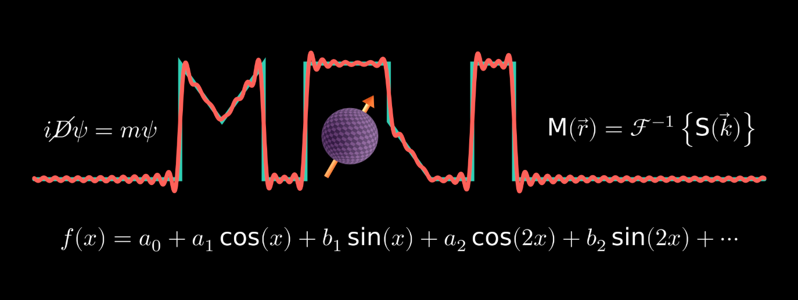
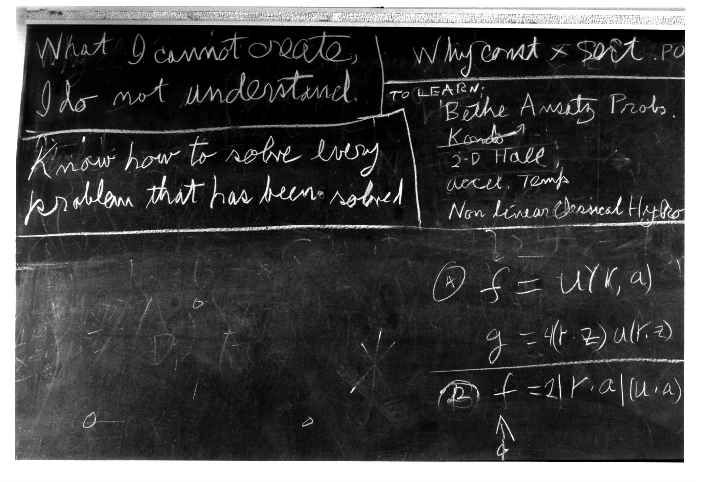

> "Reimagining MRI Physics Education!”
> 
-- by the Art of MRI Physics (AoMP) 

<figure style="margin: 0rem; padding-top: 0.5rem;">
  
</figure>

  

Hello interested readers! 

Welcome to the **Art of MRI Physics (AoMP)** series, where we explore the fascinating world of MRI and its principles. 

Before introducing **the AoMP series**, let's start with a challenge.

# The Opening Challenge

Below is the AoMP's official trailer (**sound on**). Can you tell:

+ What the are these?
+ Why do they have to do with MRI?
+ **Bonus**: What is the hidden “thread” woven all these concepts together?

I look forward to hearing your solutions. You can share them in any of the following ways:

+ [Email me directly](mailto:hdoMRIphysics@gmail.com).
+ Join the discussion on [Substack](https://hdomriphysics.substack.com/archive) (find the post with the same **AoMP title**).
+ Leave a comment in the **comments section** at the bottom of this page (sign in with your GitHub account).

  <iframe 
    style="position: absolute; top: 0; left: 0; width: 100%; height: 100%;"
    src="https://www.youtube.com/embed/VW071zbj7pE" 
    frameborder="0" 
    allow="accelerometer; autoplay; clipboard-write; encrypted-media; gyroscope; picture-in-picture" 
    allowfullscreen>
  </iframe>

Introducing the AoMP series -- Official Trailer (see <a href="https://youtu.be/VW071zbj7pE" target="_blank">YouTube</a> if the video does not load).

# Mission

> "To create original tutorials and challenges related to fundamental physics, mathematics, signal processing, Fourier analysis, and MRI physics. The goal is to present complex ideas with clarity so that they become memorable.”
> 
-- The Art of MRI Physics (AoMP) 

**The Art of MRI Physics (AoMP)** is a precise and carefully-crafted distillation of my 15+ years of experience in physics, mathematics, signal processing, Fourier analysis, and MRI physics. AoMP covers foundational concepts in these areas with an emphasis on intuitive understanding but without sacrificing rigor and accuracy. 

With the help of Artificial Intelligence (AI), it is easy to create attention-grabbing content. However, without the author's unique perspective and expertise, the content often lacks originality and is even misleading. The AoMP series is different. It is a collection of original work that I have been tinkering with for years. It is a labor of love, and I hope it will be enjoyable for anyone interested in learning about the fundamental concepts of MRI physics.

Here is one example: if you want a single MRI physics–related takeaway from AoMP, the following quote provides a concise distillation of the essence of MRI physics. It may be too vague for now, but I hope it will become clearer and clearer as you explore the AoMP series.

> "To understand MRI, think in terms of rotating arrows."
> 
-- The Art of MRI Physics (AoMP) 

A more technical one is the following quote:

> "To understand MRI, think Fourierly."
> 
-- The Art of MRI Physics (AoMP) 

# Why AoMP?

[Magnetic Resonance Imaging (MRI)](https://en.wikipedia.org/wiki/Magnetic_resonance_imaging) is an indispensable medical imaging modality. Each year, approximately 100 to 150 million MRI scans are performed worldwide. In other words, about one to two MRI scans being initiated every second somewhere in the world. Given that a typical MRI exam lasts approximately 30 minutes, there are roughly 1,500 to 2,000 MRI scans in progress at any given moment. Most likely, you or someone you know has had an MRI scan, or will have one in the future.

However, MRI is often perceived as complex and difficult to understand. AoMP aims to demystify MRI physics making it accessible to a broader audience. I believe that anyone can fully understand MRI regardless of prior background.

Although many resources for learning MRI physics exist, none provides a comprehensive and accurate treatment of foundational concepts for non-physicists. Even for those who have a background in physics, the complexity of MRI physics can be overwhelming when starting out. The AoMP series aims to fill these gaps by providing a comprehensive and intuitive introduction to MRI physics for non-physicists, while also offering a rigorous and accurate treatment of foundational concepts for those with a background in physics. 

For serious learners, I strongly recommend following the bibles of MRI physics cover to cover, the book ["Principles of Magnetic Resonance Imaging: A Signal Processing Perspective"](https://www.amazon.com/dp/B010WEWW2C) by Zhi-Pei Liang and Paul C. Lauterbur and the book ["Magnetic Resonance Imaging: Physical Principles and Sequence Design"](https://www.amazon.com/dp/0471720852) by Robert W. Brown, Y. C. N. Cheng, E. Mark Haacke, Michael R. Thompson, and Ramesh Venkatesan. These books are excellent resources for those who want to be MRI physicists. However, these books can be overwhelming to start with and lacks accessibility. The AoMP series is not a replacement for these text books but aims to provide a more accessible and intuitive introduction to MRI physics, providing the fastest path to understanding MRI physics even for physicists.

We are living in an age of constant information bombardment fueled by social media. The situation is only worsen by the rapid rise of low-effort AI-generated content. Generating content is cheap but verifying the accuracy of the content is not. Therefore, it is easy to get lost in the noise or misled by misinformation.

I have noticed that many posts simply are regurgitations of latest news or repackaging of existing content. The AoMP series is different. It reflects my curiosity and desire to understand the underlying principles of MRI physics. 

The "internet ocean" is over "polluted" with low-effort and unverifiable content. My goal is to keep the "internet ocean" a little cleaner by only sharing what I find genuinely interesting and insightful.

Much of what we encounter online is algorithmically optimized to capture attention rather than to promote genuine learning. Generative AI can further short-circuit the learning process, tempting readers to seek immediate answers (though potentially inaccurate) without critical reflection. The long-term consequences for critical thinking and creativity remain to be seen, but without proper safeguards, the risks are clear.

To counter this trend, I have chosen, whenever possible, to structure posts as challenges designed to spark curiosity, encourage active learning, and strengthen critical thinking. I believe in our innate curiosity, and I hope these challenges foster deeper learning while offering a refreshing alternative to the passive consumption of information that dominates many online platforms.

A word of caution: the AoMP series is not a fast-food style learning resource. It requires time and effort to engage with the material, but I believe that the rewards are worth it.

# Style and Format

AoMP will utilize illustrations and/or animations to help explain complex concepts, when appropriate and for rigorousness, mathematics and physics derivations are included. Each post will be structured as a challenge or question (**AoMP-xxx-Q**) followed by a detailed solution or answer (**AoMP-xxx-A**), where "xxx" is a three-digit number starting from 000. The three digits in the answer post correspond to those in the question it addresses. Posts that are not suitable for the challenge format, will be labeled as **AoMP-xxx**.

Take the AoMP-000-Q post as an example. You will find a challenge in the [**AoMP's Opening Challenge**](#the-opening-challenge) section above. The solution to this challenge will be presented in a future post, AoMP-000-A. Note that, this is an introductory post so the challenge is a bit abstract and high-level. Future challenges will be more concrete and specific, and will be designed to help you learn and understand the underlying principles of MRI physics one at a time.

# Scope of AoMP

Although AoMP is primarily focused on MRI physics, it also covers foundational topics in mathematics, physics, signal & image processing, and Fourier analysis.

AoMP presents a precise distillation of my 15+ years of experience in MRI physics, signal processing, and mathematics, offering original perspectives and insights that have not been articulated elsewhere.

# Target Audience

AoMP is designed for a broad audience, including students, researchers, MRI technologists (radiographers), clinicians, professionals whose work indirectly involves MRI (including sales, marketing, legal, regulatory, etc.). It is also intended for any curious readers, even K-12 students, who are interested in learning about this remarkable technology.

For those who works directly or indirectly with MRI, understanding how MRI works will give you a little more joy to your work. I can assure you that, because that is what I experience.

The material presented in AoMP also offers value to physicists, engineers, and educators, as it reflects the kind of resource I would consume myself.

# My Approach and Philosophy

My learning philosophy is similar to what Richard Feynman expressed in his quote:

> "What I cannot create, I do not understand." 
> 
-- Richard Feynman (1918-1988) 

To truly understand a concept, I often re-create it myself, whether through mathematical derivation, visualization, or numerical simulation. This process forces me to engage deeply with the material and develop a deep understanding of the underlying principles. Many times, I find that creating something from scratch leads to original insights and unique perspectives that have not been seen before. 

<figure style="margin: 0rem; padding-top: 0.5rem;">
  
</figure>

Richard Feymann's blackboard (<a href="https://digital.archives.caltech.edu/collections/Images/1.10-29/" target="_blank">Source</a>)

For a focused research direction, Feymann's approach is, at least from my experience, the most effective way to achieve deep understanding, enabling original contributions and pushing the boundaries of knowledge. However, this approach can be time-consuming and may not be the most efficient way to learn a broad range of topics, especially for those who are new to the field or are looking for a more general overview.

To mitigate that, I think:

> "If you can visualize [or see] it, you can understand it (to an useful extent)."

The goal of AoMP is to provide accurate and intuitive visualizations of complex concepts in mathematics, physics, and signal processing, Fourier analysis, and MRI physics. By doing so, I hope to make these concepts accessible and memorable. 

Because, with great visualizations,

> "Once you see it, you cannot un-see it."

It becomes part of your mental model, and can be recalled whenever needed.

Please remember that any model or visualization is, by definition, a simplification of reality as George E. P. Box famously said:

> "Essentially, all models [visualizations] are wrong, but some are useful."
> 
-- George E. P. Box (1919-2013) 

With that in mind, my goal is to create visualizations that are useful, but as little wrong as possible.

Another Feymann's quote that I find relevant is:

> "The ultimate test of your knowledge is your capacity to convey it to another."
> 
-- Richard Feynman (1918-1988) 

AoMP is an attempt to test my ability to convey complex concepts to a broader audience, helping them understand and appreciate the beauty of mathematics, physics, and the remarkable technology of MRI.

Lifelong learning is a continuous and proactive process. Although you can quickly grasp key insights from the animations and illustrations, when possible, I encourage you to learn from **first principle** by creating or deriving concepts from scratch. This process can lead to deeper understanding and insights that you may not gain otherwise.

# Who is Behind AoMP?

My name is Hung Do, PhD MSEE, and I am an MRI physicist by training. I obtained my PhD in MRI Physics and Master of Science Degree in Electrical Engineering with emphasis in image and signal processing from the [University of Southern California (USC)](https://www.usc.edu/), Los Angeles, California, USA. I was trained by a well-known MRI scientist, [Prof. Krishna Nayak](https://mrel.usc.edu/), who was trained at of the most well-known MRI research labs, [Magnetic Resonance Systems Research Lab (MRSRL)](https://mrs.stanford.edu/) at Stanford University, California, USA. I am indebted to Dr. Nayak for his mentorship and guidance, which has been invaluable in shaping my understanding of MRI physics and research.

Prior to my PhD, I obtained my Bachelor of Science in Theoretical Physics from the [Hanoi National University of Education](https://www.hnue.edu.vn/), Vietnam, completed 1-year of Master of Science study in Theoretical Physics at the [Institute of Physics](https://iop.vast.vn/index.php?&lang=en), Vietnam Academy of Science and Technology, and obtained my Diploma Degree in Condensed Matter Physics at the [International Centre for Theoretical Physics (ICTP)](https://www.ictp.it/), Trieste, Italy. Please see my [resume](https://hdocmsu.github.io/resume/) for more details about my educational background and professional experience.

Since 2017, I have been working as an MRI physicist at [Canon Medical Systems USA](https://us.medical.canon/), Inc., Cleveland, Ohio, USA, where I work to translate latest MRI technologies into clinical practice. One of my responsibilities is to educate and collaborate with clinicians, researchers, and technologists on Canon's MRI technologies. I have also been continuously distilling MRI physics concepts and MRI latest technologies into educational materials for our sales and marketing teams, and for our customers. I have also been actively involved in MRI research and have published several papers in peer-reviewed journals and conferences, giving talks at various scientific meetings and internal training sessions. Feel free to check out my [publications](https://hdocmsu.github.io/publications/), [projects](https://hdocmsu.github.io/projects/) and [talks](https://hdocmsu.github.io/talks/) for more information.

# How You Can Support AoMP?

I prioritize **quality over quantity**, so posts are published on an irregular schedule. The best way to stay informed about future posts is to subscribe to the [free Substack newsletter](https://hdomriphysics.substack.com/about) and receive new posts, challenges, and videos directly in your inbox. 

          <form action="https://{{ site.substack_username }}.substack.com/api/v1/free?nojs=true" method="post" style="margin: 0.0rem; margin-bottom: 0.0rem;">
            <input type="email" name="email" placeholder="Enter your email" required 
                  style="width: 100%; padding: 0.5rem; margin-bottom: 0.5rem; border: 1px solid var(--global-divider-color); border-radius: 8px; background-color: var(--global-bg-color); color: var(--global-text-color); font-size: 1rem;">
            <button type="submit" 
                    style="width: 100%; padding: 0.5rem; background-color: var(--global-theme-color); color: rgb(0, 0, 0); border: none; border-radius: 8px; font-weight: bold; cursor: pointer; font-size: 1rem;">
              Subscribe (Substack newsletter)
            </button>
          </form>
        

 

Subscribing, liking, sharing it with others, and commenting on posts are all great ways to support AoMP and help it reach interested audience.

If you would like to see more of this and want to support my work further, you can <strong>buy me a coffee</strong> or become a <strong>monthly sponsor</strong> via Ko-fi.com.

    

 

Your support helps fund deeper and long-term explorations.

<em>Cheers -- and MRI on!</em>

<em>-- The Art of MRI Physics (AoMP)</em>

