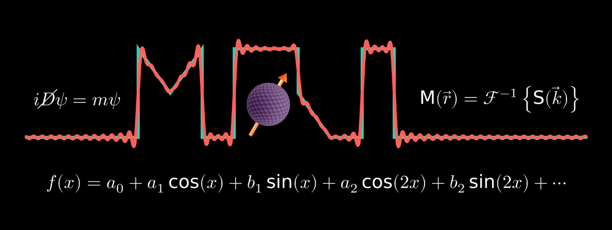

> "Reimagining MRI Physics Education!”
> 
-- by the Art of MRI Physics (AoMP) 

<figure style="margin: 0rem; padding-top: 0.5rem;">
  
</figure>

# Mission

> "To create original (unique and rigorous) tutorials and challenges related to fundamental physics, mathematics, signal processing, Fourier analysis, and MRI physics. The goal is to present complex ideas with clarity so that they become understandable and memorable.”
> 
-- The Art of MRI Physics (AoMP) 

# Coming soon

Stay tuned for updates!

# Work-in-progress

This is work-in-progress.