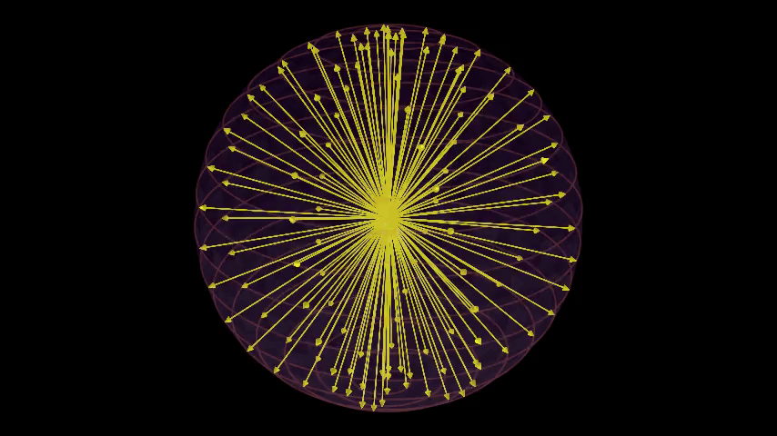
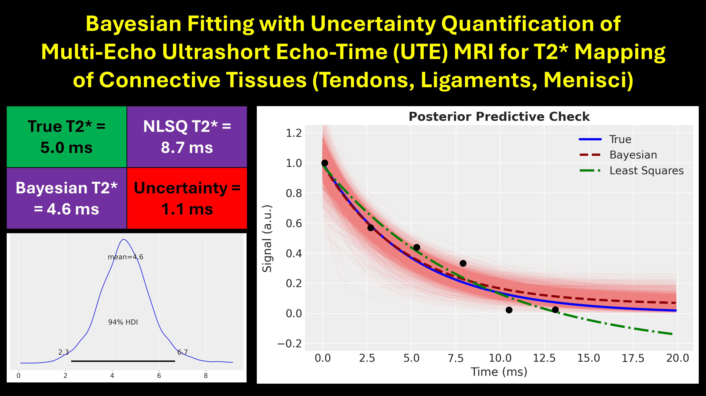
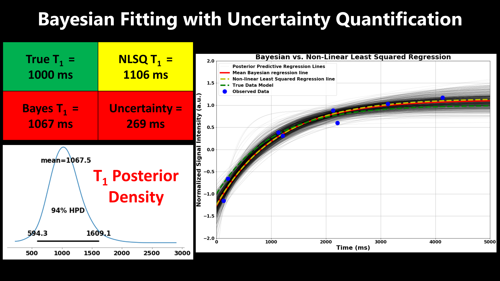

> In quantitative Physics, it is unthinkable to report measurements without associated uncertainties. However, in quantitative MRI (qMRI), uncertainty quantification is largely ignored as none of commercially available qMRI solutions provide uncertainty estimates. 
> 
> This project demonstrates that Bayesian fitting can be easily integrated into qMRI pipelines to provide uncertainty quantification, which would help clinicians decide whether the abnormal values are due to underlying pathologies or due to spurious confounding factors. 
> 
> Additionally, it is natural to incorporate prior knowledge into the Bayesian framework that in turn helps improve the accuracy and precision of qMRI measurements, especially in low signal-to-noise ratio (SNR) scenarios due to scan time acceleration.

# Work-in-progress (WIP)

Stay tuned for updates!

# WIP-1: Ultrashort Echo Time (UTE) T2* mapping

<figure>
  
  <figcaption style="font-size: 0.85em; font-style: italic; text-align: center;">T2* decay of typical musculoskeletal tissues and Echo times (TEs) of the UTE sequence.</figcaption>
</figure>

<figure>
  
  <figcaption style="font-size: 0.85em; font-style: italic; text-align: center;">K-space trajectories of UTE MRI.</figcaption>
</figure>

<figure>
  
  <figcaption style="font-size: 0.85em; font-style: italic; text-align: center;">Demonstration of Uncertainty Quantification in Quantitative Ultrashort Echo Time (UTE) T2* mapping.</figcaption>
</figure>

# WIP-2: Myocardial T1 mapping
<figure>
  
  <figcaption style="font-size: 0.85em; font-style: italic; text-align: center;">Demonstration of Uncertainty Quantification in Quantitative Myocardial T1 mapping.</figcaption>
</figure>

