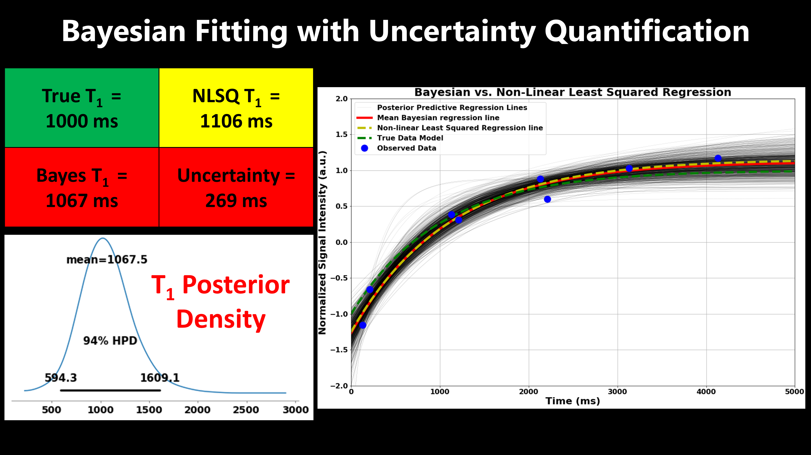

> In quantitative Physics, it is unthinkable to report measurements without quantifying the associated uncertainties. In quantitative MRI (qMRI), uncertainty quantification (UQ) is largely missing as none of commercially available qMRI solutions provide uncertainty estimates. 
> 
> This project demonstrates that Bayesian fitting can be easily integrated into qMRI pipelines to provide uncertainty estimates, which would help clinicians and researchers to decide whether the abnormal values are due underlying pathology or simply due spurious confounding factors. 
> 
> Additionally, it is natural to incorporate prior knowledge into the Bayesian framework that help improve the accuracy and precision of qMRI measurements, especially in low signal-to-noise ratio (SNR) scenarios due to scan time acceleration.

# Work-in-progress

Stay tuned for updates!

<figure>
  
  <figcaption style="font-size: 0.85em; font-style: italic; text-align: center;">Demonstration of Uncertainty Quantification in Quantitative Myocardial T1 mapping.</figcaption>
</figure>

