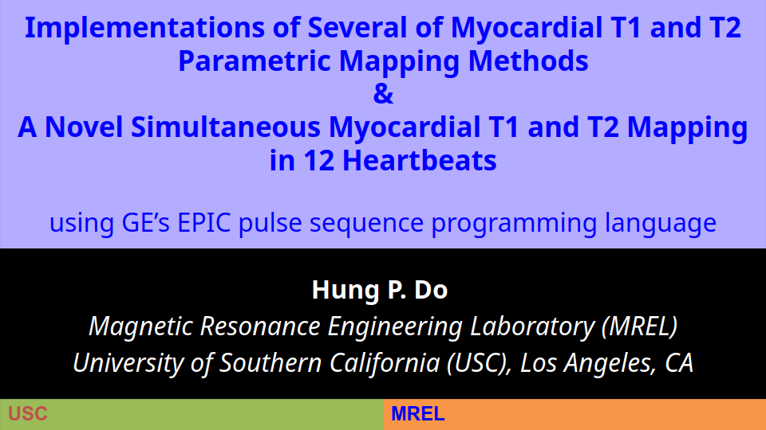
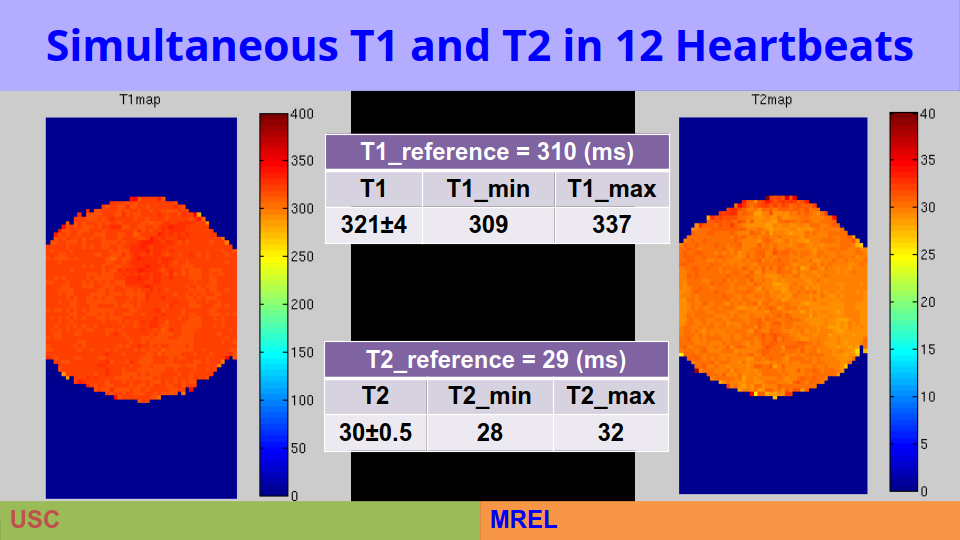
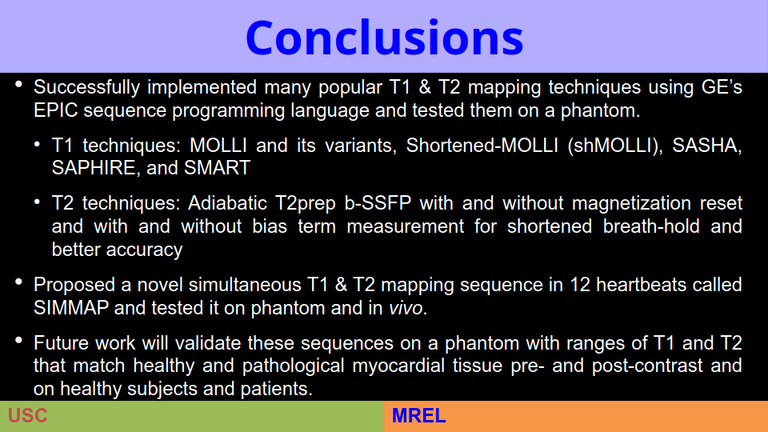

> In this project, I re-implemented several popular T1 and T2 mapping techniques (MOLLI and its variants, Shortened MOLLI, SASHA, SAPHIRE, and SMART for T1 mapping and adiabatic T2-prep b-SSFP T2 mapping with and without magnetization reset pulses and with and without bias correction measurements) and proposed a novel approach to accurately and simultaneously map T1 and T2 relaxation times of the myocardium in a single 12-heartbeat breath-hold.
>
> This project involves MRI pulse sequence programming of several popular T1 and T2 mapping techniques, image reconstruction, and phantom & in vivo experimental validations.

<figure>
  
  <figcaption style="font-size: 0.85em; font-style: italic; text-align: center;">Title slide of my talk.</figcaption>
</figure>

<figure>
  
  <figcaption style="font-size: 0.85em; font-style: italic; text-align: center;">Phantom validation of the novel simultaneous T1 and T2 mapping technique.</figcaption>
</figure>

<figure>
  
  <figcaption style="font-size: 0.85em; font-style: italic; text-align: center;">Conclusion slide of my talk.</figcaption>
</figure>