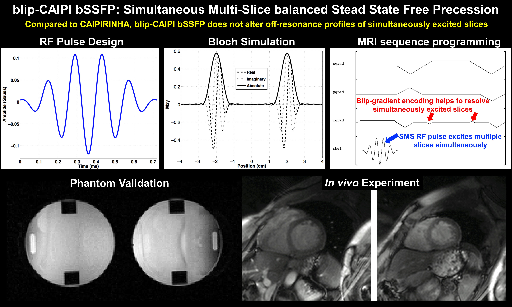

> This project proposes a novel approach to shorten the acquisition time of balanced steady-state free precession (bSSFP) MRI, the most SNR- and CNR-efficient technique for cardiac imaging. Conventional simultaneous multi-slice (SMS) MRI utilizes RF phase modulation, which spatially shifts the profile of the banding artifacts of the simultaneously excited slices, making it impossible to achieve simultaneously optimal shimming for two slices. The proposed method, blip-CAIPI (blipped-Controlled Aliasing in Parallel Imaging) bSSFP, maintains the spatial positioning of the banding artifacts by using gradient encoding along slice-select direction instead of the RF phase modulation used in conventional SMS MRI. 
>
> This project involves radiofrequency (RF) excitation pulse design, Bloch simulations, MRI pulse sequence programming, image reconstruction, and phantom & in vivo experimental validations.

<figure>
  
  <figcaption style="font-size: 0.85em; font-style: italic; text-align: center;">Overview of the blip-CAIPI bSSFP Technique. Radiofrequency (RF) excitation pulse design, Bloch simulations, MRI pulse sequence programming, and phantom & in vivo validation results on the heart.</figcaption>
</figure>
