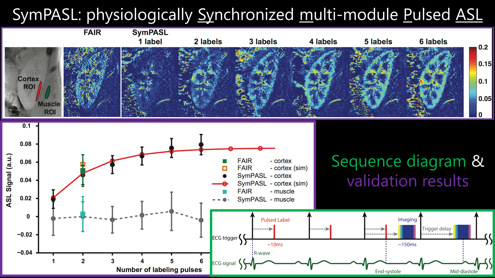

> This project proposes a novel approach to improve the signal-to-noise ratio (SNR) and sensitivity of Arterial Spin Labeled (ASL) MRI, a non-contrast perfusion imaging technique that is inherently signal-starved. The proposed method, SymPASL (physically-Synchronized multi-module Pulsed ASL), utilizes a synchronized multi-module pulsed ASL sequence to enhance the SNR and sensitivity of perfusion imaging, enabling more accurate and reliable assessment of tissue perfusion without the need for contrast agents.
>
> This project involves numerical simulations, MRI sequence programming, and in vivo experimental validations.

<figure>
  
  <figcaption style="font-size: 0.85em; font-style: italic; text-align: center;">Overview of the SymPASL Technique. Simulation and in vivo validation results.</figcaption>
</figure>
